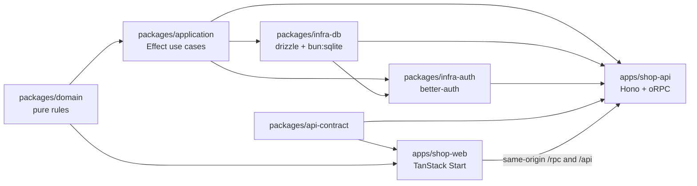

# Architecture

The shop is a Bun workspace of small packages. Each package has one job, and the direction of
imports is fixed so a business rule has exactly one home.

## The layers

| Package                 | What it holds                                                                                                 | May import                          |
| ----------------------- | ------------------------------------------------------------------------------------------------------------- | ----------------------------------- |
| `packages/domain`       | Pure types and functions: money in minor units, products, roles. No I/O, no Effect services, no dependencies. | nothing                             |
| `packages/application`  | Use cases written in Effect and the repository ports they need (`ProductRepository`, `SessionReader`).        | `domain`                            |
| `packages/api-contract` | The oRPC contract (procedures, outputs, error codes) and its schemas.                                         | `domain`                            |
| `packages/infra-db`     | The drizzle schema, migrations, seed, and repository implementations as Effect layers.                        | `application`, `domain`             |
| `packages/infra-auth`   | better-auth over the same SQLite file, the `SessionReader` adapter, the demo users.                           | `application`, `domain`, `infra-db` |
| `apps/shop-api`         | Hono on `Bun.serve`, the oRPC router, the session and role checks, `getTestApp()`.                            | everything above                    |
| `apps/shop-web`         | TanStack Start pages.                                                                                         | `api-contract`, `domain`            |

## Rules of the road

- `domain` imports nothing. A rule is a pure function with a doc comment that states it, and a test.
- `application` imports `domain` only. It defines ports (what it needs) and never an implementation.
- `infra-*` packages implement the ports. They may import `application` and `domain`, never an app.
- Apps may import every package, with one exception: **the web app never imports `infra-db` or
  `infra-auth`**. Server code and its secrets stay out of the browser bundle.
- The contract is the only thing the web app and the api share for HTTP. The web builds a typed
  client from it; the api implements it. Everything else crosses the wire as JSON.
- The api decides who may do what: roles are checked in `application` (`requireAdmin`) and enforced
  in the router. Hiding a page in the web app is a convenience, never a control.
- The web app never computes a price the api trusts. It shows what the api returns.

## Data

SQLite is one file, `data/shop.db`, opened in-process with `bun:sqlite`. There is no server and no
Docker. The shop tables and better-auth's tables (`user`, `session`, `account`, `verification`) live
in the same file and are created by one migration set in `packages/infra-db/drizzle`.

- Money is an integer in minor units (1999 is 19.99). Dates are integers (milliseconds since the
  epoch).
- `bun run db:reset` deletes the file, applies the migrations with drizzle's `bun-sqlite` migrator,
  and seeds the demo catalog and users.
- To change the schema, edit `packages/infra-db/src/schema.ts` and run `bun run db:generate`.

## Authentication

better-auth uses its drizzle adapter (provider `sqlite`) on the shop database. Email and password
sign-in is on. A user has a `role` column (`admin` or `customer`); a sign-up request cannot choose
it, so new accounts are customers. The browser talks only to the web origin: in development the Vite
server forwards `/rpc` and `/api` to the api, so the session cookie is same-origin.

## Tests

- Domain and application tests are plain `bun test` files. Application tests use the in-memory
  layers from `@demo-shop/application/testing`.
- Api tests use `getTestApp()` from `apps/shop-api/src/test-app.ts`. It is memoized, so the app (an
  in-memory database, migrated and seeded) is built once per test process.
- Tests import their fixtures and never read inputs with `node:fs`, because `bun test --changed`
  follows imports and would miss a file that is only read at run time.
- CI shards the suite by the timings in `.bun-test-timings.json`. A pull request runs only the tests
  affected by its changes; `main` runs everything and refreshes the timings.
